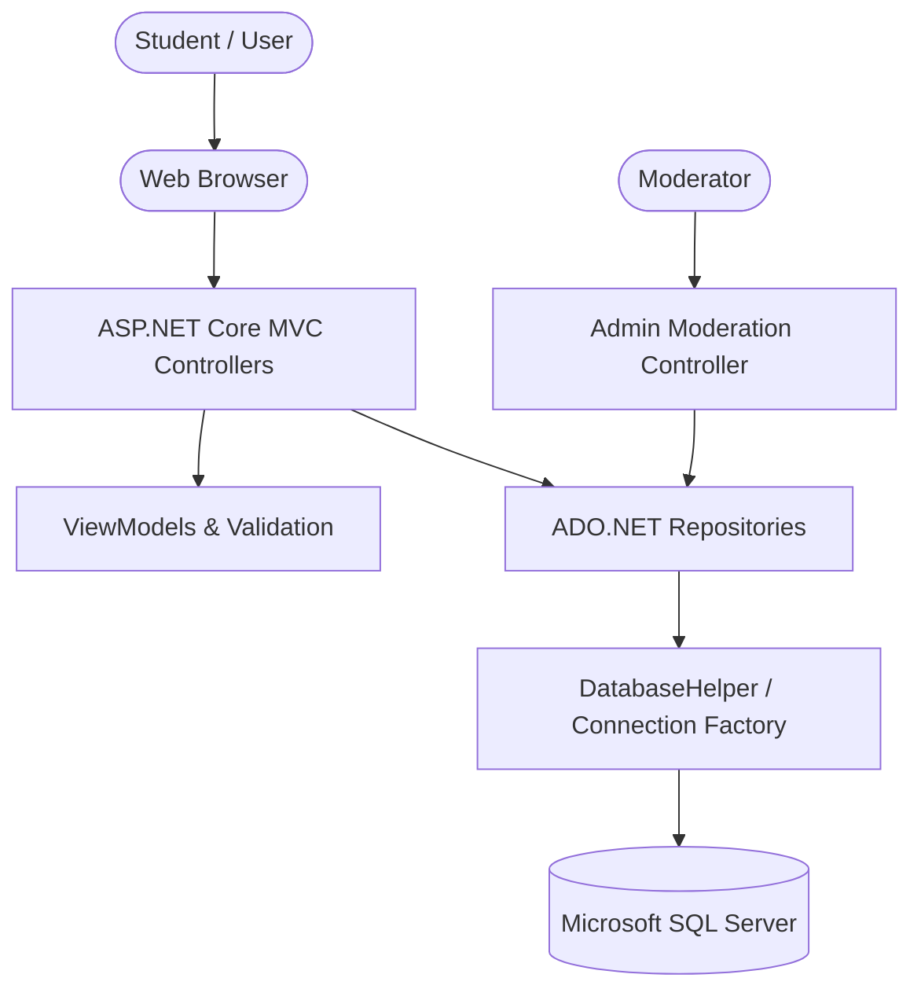

# Academic Project Report: Anonymous Sharing Platform (WhisperSpace)

**Course:** B.Tech Computer Science & Engineering (Semester 5)  
**Subject:** .NET Technologies (Mini Project)  
**Student:** Vicky Mahto  
**Repository:** [https://github.com/vickymahto31/.NET-Project](https://github.com/vickymahto31/.NET-Project)  

---

## 1. Introduction & Problem Statement
College students frequently experience high levels of stress stemming from academic expectations, semester exams, campus placement preparation, hostel conflicts, and social isolation. Due to fear of negative peer judgment or professional consequences, students often hesitate to discuss their struggles openly.

**WhisperSpace** solves this challenge by providing a secure, anonymous web platform where students can express their thoughts, ask for advice, and offer mutual encouragement without revealing their identity.

---

## 2. Technology Stack & Constraints Adherence
In strict accordance with the project guidelines:
* **Programming Language:** C# (C# 12 / .NET 8.0)
* **Application Framework:** ASP.NET Core MVC (Model-View-Controller)
* **Data Access Layer:** ADO.NET (`Microsoft.Data.SqlClient`)
  * Classes used: `SqlConnection`, `SqlCommand`, `SqlDataReader`, `SqlParameter`, `SqlConnectionStringBuilder`
  * Strictly no Entity Framework or third-party ORMs.
* **Database Management System:** Microsoft SQL Server
* **Frontend:** Vanilla HTML5, Vanilla CSS3, Vanilla JavaScript (No React, Node.js, Python, or PHP).

---

## 3. System Architecture

The application adopts an N-Tier architecture following the **Repository Pattern** and **MVC (Model-View-Controller)** pattern:

### Architectural Components:
1. **Presentation Layer (Razor Views):** Renders HTML views using responsive Vanilla CSS (`site.css`) and client-side micro-interactions (`site.js`).
2. **Controller Layer (C#):** Handles HTTP requests, enforces data validation, and routes view rendering.
   * `HomeController`: Landing overview, statistics, and community guidelines.
   * `PostsController`: Post listing, filtering, search, submission, and support votes.
   * `CommentsController`: Threaded supportive replies.
   * `AdminController`: Protected moderation operations and report handling.
3. **Data Access Layer (ADO.NET):** Encapsulated behind repository interfaces (`IPostRepository`, `ICategoryRepository`, `ICommentRepository`, `IReportRepository`, `IAdminRepository`).
4. **Database Layer (SQL Server):** Relational tables enforced with primary keys, foreign keys, and indexes.

---

## 4. Database Schema Design

### Entity Relationship Structure
* `Categories (1)` ─── `(N) Posts`
* `Posts (1)` ─── `(N) Comments`
* `Posts (1)` ─── `(N) Reports`
* `Admins` (Independent moderation entity)

### Data Dictionary

| Table Name | Column Name | Data Type | Constraint | Description |
|---|---|---|---|---|
| **Categories** | `CategoryId` | `INT` | Primary Key, Identity | Unique Category ID |
| | `Name` | `NVARCHAR(100)` | NOT NULL | Category name |
| | `Description` | `NVARCHAR(300)` | NOT NULL | Summary of category purpose |
| | `IconClass` | `NVARCHAR(50)` | NOT NULL | UI icon identifier |
| | `BadgeColor` | `NVARCHAR(30)` | NOT NULL | Hex color for UI pill |
| **Posts** | `PostId` | `INT` | Primary Key, Identity | Unique Post ID |
| | `Title` | `NVARCHAR(200)` | NOT NULL | Title of thought/vent |
| | `Content` | `NVARCHAR(MAX)` | NOT NULL | Long-form post content |
| | `CategoryId` | `INT` | Foreign Key (Categories) | Associated category |
| | `MoodTag` | `NVARCHAR(50)` | NOT NULL | Emotion tag |
| | `AuthorAlias` | `NVARCHAR(80)` | Default 'Anonymous Student'| Pseudonym alias |
| | `SupportCount` | `INT` | Default 0 | Peer encouragement count |
| | `ReportCount` | `INT` | Default 0 | Inappropriate flag count |
| | `IsHidden` | `BIT` | Default 0 | Soft-hide state flag |
| | `CreatedAt` | `DATETIME2` | Default GETDATE() | Post publication timestamp |
| **Comments** | `CommentId` | `INT` | Primary Key, Identity | Unique Comment ID |
| | `PostId` | `INT` | Foreign Key (Posts) | Parent post |
| | `AuthorAlias` | `NVARCHAR(80)` | Default 'Supportive Peer' | Commenter alias |
| | `Content` | `NVARCHAR(1500)`| NOT NULL | Supportive text reply |
| | `CreatedAt` | `DATETIME2` | Default GETDATE() | Comment timestamp |
| **Reports** | `ReportId` | `INT` | Primary Key, Identity | Unique Report ID |
| | `PostId` | `INT` | Foreign Key (Posts) | Flagged post |
| | `Reason` | `NVARCHAR(100)` | NOT NULL | Category of violation |
| | `DetailedRemarks`| `NVARCHAR(500)`| NULL | Optional user remarks |
| | `Status` | `NVARCHAR(50)` | Default 'Pending' | Pending/Reviewed/Dismissed |
| | `CreatedAt` | `DATETIME2` | Default GETDATE() | Report timestamp |
| **Admins** | `AdminId` | `INT` | Primary Key, Identity | Unique Admin ID |
| | `Username` | `NVARCHAR(50)` | UNIQUE, NOT NULL | Moderator login |
| | `PasswordHash` | `NVARCHAR(256)`| NOT NULL | SHA-256 hashed password |
| | `FullName` | `NVARCHAR(100)`| NOT NULL | Display name |

---

## 5. Security & Privacy Implementations
1. **Protection against SQL Injection:** All dynamic data queries are parameterized using `SqlParameter` objects with strict `SqlDbType` mappings. No raw string interpolation is used.
2. **Cross-Site Request Forgery (CSRF) Prevention:** All state-changing HTML forms are secured with `@Html.AntiForgeryToken()` and validated with `[ValidateAntiForgeryToken]` in controllers.
3. **Password Security:** Administrator passwords are never stored in plaintext. They are hashed using `SHA-256` before verification against the database.
4. **Anonymity Safeguard:** No personal data (names, student roll numbers, or IPs) is stored alongside community content.

---

## 6. Testing & Demonstration Results
The application was built and validated with zero compilation errors and tested across all core functional workflows:
* **Anonymous Post Creation:** Tested with character bounds and community rules pledge.
* **Feed Filters & Search:** Tested category selection, mood filters, and SQL `LIKE` parameter search.
* **Reactions & Comments:** Verified that support counters and threaded replies persist correctly.
* **Flagging & Admin Moderation:** Verified that reporting a post increments the report count and immediately escalates the post to the admin moderation console for review or deletion.

---

## 7. Conclusion & Future Scope
The Anonymous Student Sharing Platform successfully fulfills all syllabus and project guidelines for the B.Tech Semester 5 .NET Technologies mini project. 

### Future Enhancements:
* Automated sentiment analysis using ML.NET to detect urgent crisis keywords and provide instant helpline popups.
* Anonymous polls and campus survey widgets.
* Integration of WebSockets (SignalR) for real-time live support counters.
